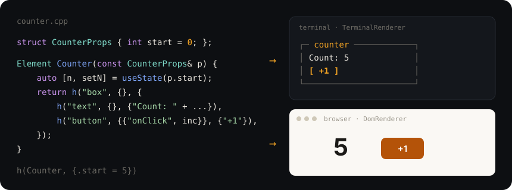

<div align="center">


# ReactX

**React in C++26. The same component code runs in a terminal and in a browser.**

[Русский](README.ru.md) · **English**

[](https://github.com/sargisis/ReactX/actions/workflows/pages.yml)
[](CHANGELOG.md)
[](https://sargisis.github.io/ReactX/docs/safety)
[](https://sargisis.github.io/ReactX/docs/browser)
[](https://sargisis.github.io/ReactX/)
[](#license)

[Site and docs](https://sargisis.github.io/ReactX/) · [Quick start](#quick-start) · [Examples](examples) · [Changelog](CHANGELOG.md) · [For AI assistants](#for-ai-assistants)



</div>

> The documentation site is in English and Russian; the [CHANGELOG](CHANGELOG.md) is in English ([Russian](CHANGELOG.ru.md)); the code, its comments, the CLI and [llms.txt](llms.txt) are in English.

## Start with an AI assistant

New to ReactX? Make a project and open its folder in Codex, Cursor or Claude Code: every project from `reactx new` has an `AGENTS.md` they read on their own. In a plain chat (ChatGPT), start with:

```text
We're using ReactX, a C++26 UI framework (not JavaScript): https://github.com/sargisis/ReactX.
Read https://sargisis.github.io/ReactX/llms.txt first — it has the whole API.
Don't invent anything that isn't there.
```

## Why ReactX

- **Like React, but C++.** Components are plain functions, state lives in hooks, and a reconciler with keys and batched updates applies the changes.
- **One codebase, two worlds.** A terminal (ANSI, Flexbox on Yoga, focus, keyboard) and a browser (WebAssembly + DOM). The ready-made `rx::ui` components look at home in both.
- **Types catch mistakes.** Props are your own struct: `h(Counter, {.start = 5})`. A typo in a field name or a wrong type is found by the compiler, not by your users.
- **The whole stack in C++.** A router, `useFetch`, its own JSON (with C++26 reflection), an HTTP server and the `reactx` CLI — no Node, npm or webpack. A counter in the browser is a 93 KB `.wasm` (41 KB over the network, gzip).
- **Modern, strict C++.** C++26 contracts, `std::expected` for errors, a hardened standard library; every push runs under ASan, UBSan and ThreadSanitizer.
- **This site is built with ReactX too:** [sargisis.github.io/ReactX](https://sargisis.github.io/ReactX/).

### ReactX or Preact?

If you write a web app and your team writes JavaScript, take Preact (or React): it is smaller and its ecosystem is huge. ReactX is for the cases where C++ is the point.

| | ReactX | Preact |
|---|---|---|
| A counter app, over the network (gzip) | ~47 KB (41 KB `.wasm` + 6 KB `.js`) | ~5 KB (the library and hooks are ~4–5 KB) |
| Before the first paint | the `.wasm` is downloaded and compiled; prerendering (`renderToString`, below) hides it | the JS is parsed and run |
| Language, types | C++26: props are structs the compiler checks | JavaScript / TypeScript |
| Also runs in a terminal | yes, the same components | no |
| JavaScript libraries | through `useNodeRef` + `rx::domElement` ([Chart.js demo](examples/web_chart.cpp)) | directly, npm |
| Server rendering | `renderToString` (no hydration yet) | `preact-render-to-string` + hydration |

Choose ReactX when the logic already is C++ (a simulation, a parser, an engine, code shared with a desktop or embedded program), when one UI should run both in a terminal and in a browser, or when the team writes C++ and doesn't want a JavaScript toolchain. Measured on this repository's `web_counter` (Release, `-Oz`); the Preact number is the size its authors publish.

## Quick start

**One line** (Linux x86-64):

```sh
curl -fsSL https://sargisis.github.io/ReactX/install.sh | sh
```

It downloads the prebuilt `reactx` into `~/.local/bin`, then `reactx install` downloads the compiler for the browser (Emscripten) and, if your system lacks them, CMake and Ninja into `~/.reactx` — no sudo, like npm. `reactx build` and `reactx dev` find them on their own (no `source emsdk_env.sh`). It needs `curl`, `git`, `python3` and `tar`; `reactx install --check` shows what is there. Terminal apps also need GCC 16+ from your package manager.

**By hand**, or on other platforms:

- **Arch Linux**:
  ```sh
  sudo pacman -S gcc cmake ninja git emscripten
  ```
  Download prebuilt `reactx` from [GitHub Releases](https://github.com/sargisis/ReactX/releases) (put in `~/.local/bin/` on your `PATH`) or build from source.

- **macOS (Homebrew)**:
  ```sh
  brew install cmake ninja git gcc emscripten
  ```
  Build `reactx` from source: `cmake --preset release -DCMAKE_CXX_COMPILER=g++-16 && cmake --build --preset release && cmake --install build/release --prefix ~/.local` (Homebrew names the compiler by its major version: `brew install gcc` gives `g++-16`; check with `ls $(brew --prefix)/bin/g++-*`).

- **Windows (WSL 2)**:
  In an elevated PowerShell run `wsl --install`. Inside WSL (Ubuntu/Arch), install `sudo apt install cmake ninja-build gcc-16 git` and Emscripten. The dev server `http://127.0.0.1:8090/` opens right in your Windows browser.

- **Ubuntu / Debian**:
  A prebuilt `reactx` for Linux x86-64 is in [GitHub Releases](https://github.com/sargisis/ReactX/releases) (`tar xzf reactx-*-linux-x86_64.tar.gz && cp reactx-*/bin/* ~/.local/bin/`). Web projects need [Emscripten](https://emscripten.org) 6+, CMake 3.28+ and Ninja; terminal projects need GCC 16+.

- **Docker** — everything is inside (GCC 16, Emscripten, `reactx`):
  ```sh
  docker run --rm -it -u "$(id -u):$(id -g)" -v "$PWD:/app" -p 8090:8090 ghcr.io/sargisis/reactx
  ```
  Inside, run `reactx dev --host 0.0.0.0`. Projects made by `reactx new` open in VS Code "Reopen in Container" and in GitHub Codespaces (`.devcontainer/`).

- **From source** (GCC 16+, CMake 3.28+, Ninja):
  ```sh
  git clone https://github.com/sargisis/ReactX.git && cd ReactX
  cmake --preset release -DCMAKE_CXX_COMPILER=g++-16 && cmake --build --preset release
  cmake --install build/release --prefix ~/.local          # ~/.local/bin/reactx
  ```

```sh
reactx new my-app && cd my-app      # a web project (or --terminal)
reactx dev                          # a C++ server; rebuilds and reloads the page on every save
```

Open http://127.0.0.1:8090/ and edit `src/main.cpp`. `reactx build --native` builds the same components for the terminal; then `main` picks the entry point: `mountDom` exists only in the browser (natively it's a clear compile error), the terminal uses `TerminalApp`:

```cpp
#ifdef __EMSCRIPTEN__
    mountDom(h(App));
#else
    TerminalApp app;  app.run(h(App));   // #include "reactx/terminal.hpp"
#endif
```

Next:

```sh
reactx build                        # build/web/dist — files for any static host; prints the .wasm size
                                    # and warns about std::format / printed doubles (~100 KB each)
reactx add magic_enum https://github.com/Neargye/magic_enum.git --rev v0.9.8 --target magic_enum::magic_enum
reactx update                       # move to the newest ReactX release
reactx install [--check]            # download Emscripten (+ CMake, Ninja if missing) into ~/.reactx
reactx dev --proxy http://127.0.0.1:5000   # /api goes to your backend (Flask, Django, Express, ...)
```

### The editor

Errors in the editor come from **clangd**: it understands C++26 like the compiler and takes the flags of the real build. The Microsoft C/C++ extension's IntelliSense doesn't know C++26 and GCC 16, and underlines correct code.

`reactx new` puts a `.clangd` and a `.vscode/` into the project: install the **clangd** extension (VS Code suggests it), run `reactx build` once, and the editor shows what the build shows. Web projects use Emscripten's own clangd (`$EMSDK/upstream/bin/clangd`), nothing to install. For a project made before v0.8.1, copy `.clangd` and `.vscode/` from a new one (`reactx new tmp`).

## What the code looks like

```cpp
#include <string>
#include "reactx/dom.hpp"       // mountDom — the browser
#include "reactx/reactx.hpp"    // Element, h, hooks, context, memo
using namespace rx;

struct TodoProps {
    std::string title{};
    bool done = false;
    Callback onToggle{};
};

Element Todo(const TodoProps& p) {
    return h("li", {{"className", p.done ? "done" : ""}, {"onClick", p.onToggle}}, {p.title});
}

Element App(const Props&) {
    auto [done, setDone] = useState(false);
    useKeyboard([setDone](const KeyEvent& k) {          // keyboard shortcuts for the whole app
        if (k.ctrl && k.key == "z") { setDone(false); return true; }
        return false;
    });
    return h("ul", {}, {
        h(Todo, {.title = "Write the reconciler", .done = done, .onToggle = [setDone, done] { setDone(!done); }}),
    });
}

int main() { mountDom(h(App)); }
```

For a terminal: `#include "reactx/terminal.hpp"` and `TerminalApp().run(h(App))` instead of `mountDom`. The components stay the same.

## What's inside

| | |
|---|---|
| **Core** | `h()` elements, fragments, keys; function components; props structs; a reconciler that reuses nodes; batched updates |
| **Hooks** | `useState`, `useEffect`, `useRef`, `useNodeRef`, `useMemo`, `useCallback`, `useContext`, `useReducer`, `useStore`, `useId`, `useTimeout`, `useInterval`, `useKeyboard`, `useDebounce`, `useLocalStorage`, `useWindowSize`, `memo<C>`, `errorBoundary` |
| **Events** | `onClick`, `onInput`, `onChange`, `onKey`, `onSubmit`, `onFocus`, `onBlur`, `onScroll`, `onPointerDown/Move/Up`, `onMouseEnter/Leave` (browser and terminal); bubbling like in React |
| **Terminal** | ANSI drawing of changed lines only, Flexbox on Yoga, borders, colors, focus, Unicode/ASCII by locale |
| **Browser** | WebAssembly + DOM, controlled inputs, SVG, event delegation |
| **Components** | `rx::ui`: buttons, inputs, checkboxes, tabs, modals, lists — themed |
| **Apps** | a router (History API), `useFetch`, JSON with reflection, an HTTP server in C++, a REST API |
| **Tools** | the `reactx` CLI (`new`, `dev`, `build`, `add`, `remove`, `update`), the `import reactx;` module, `TextRenderer` for tests |

## Reference

<details>
<summary><b>Hooks and events</b></summary>

- `useState` — a value or an updater function; an equal value doesn't re-render.
- `useEffect` — without deps (every render), `deps(a, b)` or `deps()` (once); may return a cleanup function.
- `useRef`, `useMemo` (recomputes only when deps change), `useCallback` (a handler keeps its identity until deps change).
- `useReducer(reducer, initial)` → `[state, dispatch]`: state changed by actions; the newest reducer is used.
- `useTimeout(fn, std::optional(5s))`, `useInterval(fn, 1s)` — timers on the UI thread; `std::nullopt` switches them off, unmounting cancels them.
- `useKeyboard(handler)` — keyboard shortcuts for the whole app, wherever the focus is: runs before the element's `onKey`, `return true` consumes the key; while a text field has focus, keys that type text don't reach it.
- `useDebounce(value, 300ms)`, `useLocalStorage("key", default)` (`localStorage` in the browser; natively only in memory, lost on exit; an optional third argument hears about failed saves), `useWindowSize()`.
- **Shared state** (like Zustand): `const auto Cart = createStore<std::vector<Item>>({});`, `Cart.set(v)` / `Cart.update([](auto items) { ...; return items; })` anywhere on the UI thread; `useStore(Cart)` re-renders on every change, `useStore(Cart, [](const auto& c) { return c.size(); })` only when the selected part changes.
- `useId()` — an id unique in the app and the same on every render: for `<label for>` and `aria-*`.
- **Error boundaries**: `errorBoundary([](const RenderError& e) { return h("p", {}, {e.message}); }, {children})` — when the children throw while rendering (also later, on a state update), the fallback shows instead and the rest of the app keeps working; `e.retry()` tries again. Exceptions in event handlers and effects aren't caught (as in React).
- **Context**: `createContext<T>(default)`, `ctx.provide(value, {children})`, `useContext(ctx)`; when the value changes, every reader re-renders, even through `memo`.
- **Lambda components**: `const auto Badge = [](const BadgeProps& p) -> Element { ... };` and `h(Badge, {.label = "new"})` — like a function (no captures: pass data in props).
- `rx::urlEncode(text)` / `rx::urlDecode` — a value for a query string: `"/api/logs?q=" + rx::urlEncode(q)`.
- **memo**: `h(memo<Item>, props)` skips re-rendering with the same props. For a props struct — its `operator==`; for `Props` — values with `==`, handlers equal only if they come from the same `useCallback`; elements with children always re-render.
- **Batching**: `setState` only marks the component; re-rendering happens in `flush()` (on its own after `render`, `dispatch`, `fetch` responses and timers), parents before children.

**Events** — five kinds of handlers: `Callback` (`void()`: `onClick`, `onFocus`, `onBlur`, `onSubmit`), `KeyHandler` (`void(const KeyEvent&)`: `onKey`), `InputHandler` (`void(const std::string&)`: `onInput`, `onChange`; a checkbox sends `"true"` / `"false"`, `rx::boolHandler([](bool on) { ... })` makes it a bool) `ScrollHandler` (`void(const ScrollEvent&)`: `onScroll`, with `nearBottom()` for loading more) and `PointerHandler` (`void(const PointerEvent&)`: `onPointerDown`, `onPointerMove`, `onPointerUp` — `x`, `y`, `localX`, `localY`, `button`, `buttons`, `type`; pixels in the browser, cells in a terminal). `onMouseEnter` / `onMouseLeave` are `Callback`s and don't bubble. A backend sends the data with `Root::dispatch(node, "onKey", KeyEvent{"Enter"})`; if the data doesn't fit the handler, `dispatch` returns `false`. Handlers stay in the core and are never sent to the backend.

</details>

<details>
<summary><b>Terminal</b></summary>

```cpp
#include "reactx/terminal.hpp"

struct AppProps { Callback onQuit{}; };

int main() {
    if (!Terminal::isInteractive()) return 1;
    TerminalApp app;
    app.run(h(App, {.onQuit = [&app] { app.quit(); }}));
}
```

Layout is **Flexbox**, computed by [Yoga](https://github.com/facebook/yoga) (the engine behind React Native). The unit is a terminal cell.

```cpp
h("box", {{"flexGrow", 1}, {"justifyContent", "center"}, {"alignItems", "center"}}, {   // the middle of the screen
    h("box", {{"border", true}, {"title", "Window"}, {"padding", 1}, {"gap", 1}, {"width", "60%"}}, {
        h("box", {{"direction", "row"}, {"gap", 1}}, {
            h("text", {}, {"Name:"}),
            h("input", {{"flexGrow", 1}, {"value", name}}),                          // takes the whole width
        }),
        h("box", {{"direction", "row"}, {"justifyContent", "space-between"}}, {
            h("button", {}, {"Cancel"}), h("button", {}, {"OK"}),
        }),
    }),
});
```

| Tag | Draws |
|---|---|
| `box` (and any unknown tag) | a flex container, a column by default |
| `text` | its text; wraps at words (`wrap=false` truncates) |
| `input` | a text field: `value`, `placeholder`, a `_` cursor when focused |
| `button` | `[ label ]` |

**Flex props** (like CSS): `direction` (`row`, `column`, `row-reverse`, `column-reverse`), `justifyContent` (`start`, `center`, `end`, `space-between`, `space-around`, `space-evenly`), `alignItems` / `alignSelf` (`start`, `center`, `end`, `stretch`), `flexGrow`, `flexShrink`, `flexBasis`, `flexWrap`, `width` / `height` / `min*` / `max*` (a number or `"50%"`), `padding*` and `margin*` (`X`, `Y`, `Left`, …; `margin: "auto"`), `gap` / `rowGap` / `columnGap`, `position: "absolute"` + `top` / `left` / `right` / `bottom`, `display: "none"`, `overflow: "hidden"`.

**Look**: `border`, `title`, `color`, `bg`, `bold`, `dim`, `underline`, `focusable`. Colors: `black red green yellow blue magenta cyan white gray`, `bright-<color>`. Borders are `┌─┐` in UTF-8 and `+-+` in other locales (decided with `std::text_encoding`).

**Keys**: Tab/↓ and Shift+Tab/↑ move the focus (the element that lost it gets `onBlur`, the new one `onFocus`); any key goes to the focused element's `onKey` and bubbles to its parents; in an `input`, characters and Backspace change `value` through `onInput` (keep `value` in `useState`); Enter/Space — `onClick`; Ctrl+C quits. `input`, `button` and nodes with `focusable=true` take focus; `trapFocus` keeps Tab inside a window, `opaque` clears what is under a box.

Differences from the browser: the root fills the whole terminal; `flexShrink` defaults to 1 in rows and 0 in columns (what doesn't fit in height is cut off), buttons don't shrink; a border always clips its content.

Demos: `./build/debug/todo_tui`, `./build/debug/ui_demo` (need a real terminal).

</details>

<details>
<summary><b><code>rx::ui</code> components</b></summary>

Ready-made components ([`reactx/ui.hpp`](include/reactx/ui.hpp)) themed through a context — **the same code in a terminal and in a browser**: in a terminal they are drawn with borders and characters ([`ui_terminal.cpp`](src/ui_terminal.cpp)), in a browser as HTML with `rx-*` classes and CSS that adds itself to the page ([`ui_web.cpp`](src/ui_web.cpp)).

```cpp
ui::themeProvider(ui::Theme{.accent = "magenta"}, {
    ui::tabs({.tabs = {
        {"Tasks", {
            ui::input({.value = draft, .onChange = setDraftFn, .onSubmit = addFn, .label = "New:"}),
            ui::list({.title = "List", .items = {
                ui::listItem({.label = "Buy milk", .detail = "today", .onSelect = toggleFn}),
            }}),
            ui::button({.label = "Delete all", .onClick = askFn, .variant = ui::Variant::Danger}),
        }},
        {"Settings", {ui::checkbox({.label = "Dark theme", .checked = dark, .onToggle = flipFn})}},
    }}),
    ui::modal({.title = "Sure?", .open = asking, .onClose = closeFn, .children = {/* ... */}}),
});
```

| Component | Does |
|---|---|
| `button` | `label`, `onClick`, `variant` (`Default`, `Primary`, `Danger`, `Success`), `disabled` (doesn't take focus) |
| `input` | `value`, `onChange(text)`, `onSubmit(text)` on Enter, `placeholder`, `label`; Escape clears it |
| `checkbox` | `label`, `checked`, `onToggle` (Enter / Space) |
| `tabs` | tabs `{label, content}`, `initial`; Enter on a title opens the tab |
| `modal` | `title`, `open`, `onClose` (Escape), `width`; covers what is under it, keeps the focus inside and gives it back when closed |
| `list` / `listItem` | a bordered box with a title, `emptyText`; an item: `label`, `detail` on the right, `selected`, `onSelect`, `onKey` |

Theme (`ui::Theme`): `accent`, `text`, `muted`, `success`, `warning`, `danger`, `surface`. In the browser the theme becomes CSS variables (`--rx-accent`, …), terminal color names map to a palette, CSS colors (`"#ff6600"`) work too; style them yourself through the classes `rx-btn`, `rx-btn--primary`, `rx-input`, `rx-tab--active`, `rx-modal__dialog`, `rx-item--selected`. Every component also exists as a `Props` function: `h(ui::Button, {{"label", "OK"}})`.

Demos: `./build/debug/ui_demo` (terminal) and `web_ui_demo.html` (browser).

</details>

<details>
<summary><b>In the browser (WebAssembly)</b></summary>

The [`DomRenderer`](include/reactx/dom.hpp) backend renders into the real DOM: tags are plain HTML, styling is plain CSS. `mountDom(h(App))` mounts the app into `<div id="app">`.

| Prop / event | In the browser |
|---|---|
| `className`, `style` (a CSS string), `htmlFor` | `class`, `style`, `for` |
| `value` | the field's value; the field is controlled — it shows what is in the state |
| `checked`, `disabled`, `selected` | DOM properties |
| anything else | attributes (`true` — present, `false` — removed) |
| `onClick`, `onInput(text)`, `onChange`, `onKey(KeyEvent)`, `onSubmit`, `onFocus`, `onBlur` | events; they bubble like in React; `onSubmit` doesn't reload the page |
| `onScroll(ScrollEvent)` | the element scrolled (doesn't bubble): `top` (also `scrollTop()`), `scrollHeight`, `clientHeight`, `nearBottom()` |
| `svg`, `rect`, `circle`, `path`, `g`, … | SVG in its own namespace; `svg:text`, `svg:a` for the tags HTML also has |
| `data-rx-self` | the element only gets clicks on itself, not on its children (dialog backdrops) |
| `data-rx-trap` | Tab stays inside the element; it takes focus when it appears and gives it back when removed |

**Mouse, touch and drag.** `onPointerDown` / `onPointerMove` / `onPointerUp` get a `PointerEvent` (`x`, `y`, and `localX`, `localY` from the element's corner), `onMouseEnter` / `onMouseLeave` follow the pointer; the same handlers work in a terminal, where `TerminalApp` turns the mouse on (cells instead of pixels; `app.setMouse(false)` leaves it to the terminal). `{"pointerCapture", true}` keeps moves and the release on the element after a press, even outside it (sliders); without it they go to what is under the pointer (drop targets). `ref.focus()` moves the keyboard focus from code. The kanban demo [`examples/kanban.cpp`](examples/kanban.cpp) is one source for both:

```cpp
h("div", {{"className", "card"}, {"onPointerDown", [setDragging, id](const PointerEvent&) { setDragging(id); }}}, {title}),
// ...the column under the pointer takes it:
h("div", {{"onMouseEnter", [setOver, col] { setOver(col); }},
          {"onPointerUp", [drop, col](const PointerEvent&) { drop(col); }}}, cards)
```

**Refs and JavaScript.** `useNodeRef()` gives the element itself: pass it as `{"ref", ref}` and use it in `useEffect` (it is set before effects run, and back to `0` when the element goes; any `RefHandler` works as a callback ref). In the browser [`reactx/js.hpp`](include/reactx/js.hpp) turns it into an `emscripten::val`: `rx::domElement(ref).call<void>("focus")`, or hand it to a JavaScript library; `rx::jsValue(json)` makes a JS object from JSON. Link with `reactx::js` (it adds embind, ~12 KB of JS; apps without it don't carry it). The demo [`examples/web_chart.cpp`](examples/web_chart.cpp) drives Chart.js from C++ state:

```cpp
auto canvas = useNodeRef();
auto& chart = useRef(emscripten::val::undefined());
useEffect([canvas, &chart] {
    chart = emscripten::val::global("Chart").new_(domElement(canvas), jsValue(config));
    return [&chart] { chart.call<void>("destroy"); };
}, deps());
return h("canvas", {{"ref", canvas}});
```

**Prerendering.** `rx::renderToString(h(Home))` ([`reactx/html.hpp`](include/reactx/html.hpp)) returns the HTML of components without a browser; effects don't run. Put it into the page's `<div id="app">` at build time and the page shows before the `.wasm` arrives; `mountDom` then replaces it with the live app (no hydration yet, so the first render must draw the same). The ReactX site does this for its home page: see `site_prerender` in `CMakeLists.txt`, a build of `examples/site.cpp` run under Node.

```sh
cmake --preset web && cmake --build --preset web
ctest --preset web                                     # DOM backend tests under Node
./build/debug/reactx_serve build/web --port 8090       # http://localhost:8090/
```

The result is plain `.html`, `.js` and `.wasm` files for any static host.

</details>

<details>
<summary><b>Router, data and API</b></summary>

**Router** ([`reactx/router.hpp`](include/reactx/router.hpp)) — like React Router; in the browser through the History API (the address changes, Back/Forward work, the page never reloads), in a terminal the history lives in memory:

```cpp
router::routes({
    {"/",          h(Home)},
    {"/todos",     h(TodoList)},
    {"/todos/:id", h(TodoPage)},     // router::useParam("id")
    {"*",          h(NotFound)},     // router::useLocation()
});
router::link({.to = "/todos/7", .label = "Open"});   // <a href>, Ctrl+click opens a new tab
router::navigate("/todos");  router::back();  router::useQuery("show");
```

The base path (e.g. `/ReactX/` on GitHub Pages) comes from `<base href>`; routes and links in code are written without it.

**Data** ([`reactx/fetch.hpp`](include/reactx/fetch.hpp)):

```cpp
auto todos = useFetch("/api/todos");            // again when the url changes; todos.reload()
if (todos.loading) ...; if (!todos.ok()) ... todos.errorText();
if (auto list = todos.tryJson()) for (const auto& t : list->asArray()) ...
fetch({.method = "POST", .url = "/api/todos", .body = json::object({{"title", "Milk"}}).dump()},
      [](const FetchResponse& r) { ... });

// Headers, a deadline, response headers, cancelling:
auto me = useFetch({.url = "/api/me", .headers = {{"Authorization", "Bearer " + token}}, .timeout = 5s});
FetchHandle req = fetch({.url = "/api/items", .timeout = 3s}, [](const FetchResponse& r) { r.header("etag"); });
req.cancel();                                    // the callback never runs; the browser aborts the request
```

A timeout answers with status 0 and `error == "timeout after N ms"`. `useFetch` cancels the request it replaces (new url, `reload()`) and the one of an unmounted component.

In the terminal build `fetch` and `useFetch` use the network too (since v0.7): give a full `http://` URL; the request runs on its own thread and the answer arrives on the UI thread at the next `flush()` (`TerminalApp` does it). No HTTPS there.

`setLocalFetch` is a "server inside the app": requests go to a C++ handler first, no network needed (static sites without a backend, API tests).

**Storage**: `rx::storageRead(key)` (`std::expected<std::optional<std::string>, std::string>`: no key is `std::nullopt`, an error is an error), `storageWrite`, `storageRemove` — localStorage in the browser, where writes can fail (`QuotaExceededError`, private mode). `useLocalStorage("draft", std::string(), onError)` calls `onError(reason)` when saving fails.

Working with an external backend (e.g. Python / Flask, Node.js, Go) is supported out of the box via `reactx dev --proxy http://127.0.0.1:5000` (forwarding `/api/*` to your API server). See the [Backend and Flask documentation](https://sargisis.github.io/ReactX/#backend) for integration guides and current limitations.

**Full stack** — UI and server in C++ ([examples/web_app.cpp](examples/web_app.cpp) + [examples/api_server.cpp](examples/api_server.cpp)):

```sh
cmake --build --preset web && cmake --build --preset debug
./build/debug/api_server build/web/app --port 8091 --data todos.json   # http://127.0.0.1:8091/
```

| Request | Response |
|---|---|
| `GET /api/todos` | the list |
| `POST /api/todos` `{"title": "..."}` | 201 + the new todo |
| `GET /api/todos/:id` | the todo or 404 |
| `PATCH /api/todos/:id` `{"done": true}` | the updated todo |
| `DELETE /api/todos/:id` | 204 |

Errors are `{"error": "..."}`. With `--data file.json` the todos are saved to disk atomically and survive restarts.

</details>

<details>
<summary><b>The C++ server</b></summary>

An HTTP/1.1 server of its own ([`reactx/http.hpp`](include/reactx/http.hpp), POSIX sockets, a thread per connection) — no Python or Node needed for development:

```cpp
rx::net::HttpServer server("127.0.0.1", 8090);
server.get("/api/todos/:id", [](const rx::net::Request& req) {
    return rx::net::Response::json(R"({"id": )" + req.pathParam("id") + "}");
});
server.serveDirectory("build/web", /*spaFallback=*/true);
if (auto started = server.tryStart(); !started) std::println("{}", started.error());   // port in use
server.run();   // until Ctrl+C
```

```sh
./build/debug/reactx_serve [DIR] [--port 8090] [--host 127.0.0.1] [--spa] [--base /ReactX/] [--not-found 404.html] [--quiet]
```

It serves files with the right types (`.wasm` → `application/wasm`), never outside the folder (`/../secret` → 403); `--spa` answers router paths with `index.html`, `--base` and `--not-found` mimic GitHub Pages. It is a development server (`127.0.0.1`), not for the open internet: no HTTPS, keep-alive or overload protection.

**A proxy to another backend** (like Vite's `server.proxy`): requests under a prefix go to another server and its answer comes back as is — status, headers (several `Set-Cookie` too), body; the path isn't decoded on the way.

```cpp
server.proxy("/api", *rx::net::parseUpstream("http://127.0.0.1:5000"));   // /api and /api/...
auto reply = rx::net::forward(request, {.host = "127.0.0.1", .port = 5000});   // std::expected<Response, HttpError>
```

```sh
reactx dev --proxy http://127.0.0.1:5000              # /api -> Flask on :5000
reactx dev --proxy /graphql=http://127.0.0.1:4000     # your own prefix; --proxy can repeat
```

Or in `reactx.json`: `"web": {"base": "/", "proxy": {"/api": "http://127.0.0.1:5000"}}`. Plain `http://` only; an unreachable backend gives 502 with the reason, no answer in 30 s gives 504.

</details>

<details>
<summary><b>C++ standard and safety</b></summary>

**The rule:** use everything the standard library already has, and write no stand-ins for what it doesn't. Native builds need **GCC 16**; browser builds use Emscripten 6 (libc++), which has no C++26 library yet, so shared code uses only what both have.

| Where | What we use |
|---|---|
| everywhere | `std::expected`, `std::flat_map`, `std::flat_set`, `std::format` / `std::print`, `std::from_chars` ([`reactx/parse.hpp`](include/reactx/parse.hpp)), `= delete("reason")`, `T...[0]`, `#embed` |
| terminal | `std::inplace_vector<char, 4>` — a cell's character without the heap, `std::mdspan` — the screen as `screen[row, col]`, `std::text_encoding` |
| CLI | `std::generator` — walking files, an `std::expected` chain for `reactx.json` |
| preconditions | C++26 contracts (`-fcontracts`), `<stacktrace>`, `<debugging>` |
| JSON | C++26 reflection `<meta>`: `json::to(aStruct)`, `json::from<Struct>(json)` |

Not in GCC 16 or Emscripten yet: `<hive>`, `<simd>`, `<linalg>`, `<rcu>`, `<hazard_pointer>`.

**JSON for structs with reflection** (GCC 16) — struct fields become keys, types are checked, an error says where:

```cpp
struct Dependency { std::string git; std::string rev; std::optional<std::string> target; };
struct Manifest { std::string name; std::optional<std::map<std::string, Dependency>> dependencies; };

auto m = rx::json::from<Manifest>(rx::json::parse(text));   // std::expected<Manifest, json::Error>
// error: field "dependencies": "fmt": missing field "rev"
rx::json::Value v = rx::json::to(*m);
```

Supported: `bool`, numbers, strings, `std::optional`, sequences, maps with string keys and nested structs; a field `template_` reads the key `"template"`. Enable it per target: `target_link_libraries(app PRIVATE reactx::reflection)` (not globally: GCC 16.0.1 with `-freflection` can't read the `import reactx;` module). The browser build has no reflection.

- **Hardening** (`REACTX_HARDENING`, on): out-of-bounds `v[i]`, `s[i]`, `front()` on an empty container stop the program instead of corrupting memory. Applies to programs linking ReactX too.
- **Preconditions** `REACTX_PRE(condition)` ([`reactx/contract.hpp`](include/reactx/contract.hpp)) — for programmer errors. On GCC 16 it is a C++26 `contract_assert`; without contracts the macro prints the condition, the place and the call stack.
- **Errors are values** (`std::expected`) where failure is normal: `json::tryParse`, `json::Value::require<T>` (strict reading of outside data), `FetchResponse::tryJson`, `HttpServer::tryStart`, `net::parseRequestHead`, `rx::parseNumber` / `rx::parsePort` instead of `std::stoi`, files in the CLI.
- **Sanitizers in CI**: every push runs all tests under ASan + UBSan + LeakSanitizer and under ThreadSanitizer.

</details>

<details>
<summary><b>Building from source</b></summary>

The only dependency is [Yoga](https://github.com/facebook/yoga) v3.2.1 (MIT); CMake downloads it (offline: `-DFETCHCONTENT_SOURCE_DIR_YOGA=/path/to/yoga`).

```sh
cmake --preset debug -DCMAKE_CXX_COMPILER=g++-16   # or release
cmake --build --preset debug
ctest --preset debug -LE slow                       # quick tests; without -LE also the full CLI run
./build/debug/counter                               # and todo, todo_tui, ui_demo
```

With the Makefiles generator the module turns itself off and everything builds through headers; by hand — `-DREACTX_MODULES=OFF`.

**`import` or `#include`**: `import reactx;` brings in the whole public API (include standard headers yourself; `import std;` isn't used). The headers (`reactx/reactx.hpp`) work the same — the module ([modules/reactx.cppm](modules/reactx.cppm)) only re-exports them. With `-fsanitize=undefined` or `thread` the module turns itself off (GCC can't build it then).

</details>

<details>
<summary><b>Publishing the site on GitHub Pages</b></summary>

The site is built and published automatically ([.github/workflows/pages.yml](.github/workflows/pages.yml)) on every push to `main`: native tests (GCC 16), sanitizers, the Emscripten build and web tests under Node; if all pass, `build/pages/site` is written to the **`gh-pages`** branch. Once: **Settings → Pages → Deploy from a branch → `gh-pages` / `(root)`**.

The site ([examples/site.cpp](examples/site.cpp), [web/site_shell.html](web/site_shell.html)) is ReactX: a home page with a live example, docs ([examples/site_docs.hpp](examples/site_docs.hpp)) with search and a table of contents, demos, `llms.txt`. `404.html` is a copy of the site, so direct links like `/ReactX/docs/hooks` open. Check it locally the way Pages serves it:

```sh
cmake --preset pages && cmake --build --preset pages
./build/debug/reactx_serve build/pages/site --base /ReactX/ --not-found 404.html   # http://127.0.0.1:8090/ReactX/
```

</details>

<details>
<summary><b>How it works</b></summary>

1. `h(...)` builds a tree of **elements** — an immutable description of the UI.
2. `Root::render` hands it to the **reconciler** ([src/reconciler.cpp](src/reconciler.cpp)); it keeps a tree of **fibers** — mounted elements with hook state and backend nodes.
3. On re-render the reconciler compares the new elements with the old fibers: same type and key (or position) — the fiber is updated and only changed props and text go to the backend; otherwise the old one is removed and a new one created.
4. `sync` brings the backend's children into the right order with the fewest `insertChild` / `removeChild` calls.
5. After the commit, effects run; if they change state, another pass follows right away.

| Action | Backend operations |
|---|---|
| clicking `+1` in counter | one: `text #4 = "Count: 6"` |
| checking a todo | two: the "N left" counter and `[x]` |
| reversing a keyed list | two moves, nothing created |
| deleting a todo | `remove` of one node + `destroy` of its subtree |

</details>

<details>
<summary><b>Repository layout</b></summary>

```
include/reactx/   public API: element, hooks, context, memo, router, fetch, json, http,
                  dom, terminal, ui, dsl, parse, contract, text_renderer
src/              implementation; reconciler.cpp — the core, utility_hooks.cpp — timers, keys,
                  window size, storage; dom.cpp — browser; terminal*.cpp — terminal
modules/          reactx.cppm — import reactx;
tools/            reactx.cpp — the CLI (project templates inside); serve.cpp — reactx_serve
examples/         terminal: counter, todo, todo_tui, ui_demo; browser: web_counter, web_todo,
                  web_ui_demo; full stack: web_app + api_server + todo_api.hpp;
                  the site: site.cpp + site_docs.hpp
web/              HTML shells: shell.html (demos), app_shell.html (web_app), site_shell.html (the site)
tests/            one file per area; test_cli.cpp runs the real CLI;
                  test_dom*.cpp, test_ui_web.cpp, test_web_*.cpp + web/fake_dom.js — browser under Node
cmake/            ReactXApp.cmake — reactx_add_app(); version.hpp.in
llms.txt          the API for AI assistants writing apps with ReactX
AGENTS.md         rules and checks for anyone changing ReactX itself
```

</details>

<details>
<summary><b>Common errors and what they mean</b></summary>

| You see | Why | Fix |
|---|---|---|
| `'router' is not a member of 'rx'` (or `ui`, `fetch`, `json`, `mountDom`, `TerminalApp`, `TextRenderer`) | `reactx/reactx.hpp` is the core only: elements, hooks, context, memo, store, `Root` | Include the part you use: `reactx/router.hpp`, `ui.hpp`, `fetch.hpp`, `json.hpp`, `dom.hpp`, `terminal.hpp`, `text_renderer.hpp`, `http.hpp`, `path.hpp`, `parse.hpp` — or, in a native build, `import reactx;` |
| `missing initializer for member 'CardProps::onClick'` with `-Wextra -Werror` | a props field without a default | give every field one: `Callback onClick{};`, `std::string title{};` |
| `memo<C>: the props struct needs operator==` | `memo` compares props, and `= default` is impossible when the struct holds handlers (`std::function` has no `==`) | write `operator==` yourself and compare only the data fields; pass handlers made with `useCallback` so they keep their identity |
| `use of deleted function 'rx::mountDom'` in a native build | `mountDom` is browser-only | put it under `#ifdef __EMSCRIPTEN__` and use `TerminalApp` otherwise (see "Quick start") |
| a long error about `TypedComponent` / `h(...)` with a lambda | a lambda with captures can't be a component | pass the data in props; a captureless lambda or a function works |
| `no matching function for call to 'println'` | `std::println` lives in `<print>` | `#include <print>` |
| `no matching ... PropValue` for a `size_t` / `unsigned` prop | props hold `int64_t`, `double`, `bool`, strings and handlers | `static_cast<std::int64_t>(n)` |
| run time: `component called more hooks than on its previous render` | a hook inside an `if` or a loop | call hooks at the top of the component; give list items their own component |
| run time: `precondition failed: ... onOwnThread()` | a setter was called from another thread | change state only on the UI thread: from handlers, effects, `fetch` callbacks, `useTimeout` / `useInterval` |
| CMake: `invalid reference: v0.x.y` while fetching ReactX | `"rev"` in `reactx.json` names a tag that doesn't exist | `reactx update` (or set an existing tag from GitHub Releases) |
| a test passes but checks nothing | after `setState` outside `dispatch` the tree isn't re-rendered yet | call `root.flush()` before reading `r.toString()` |

</details>

<details>
<summary><b>Current limitations</b></summary>

- Numbers like `size_t` in props need an explicit cast to `int64_t`.
- In tests, after `setState` outside `dispatch`, call `root.flush()` yourself (the browser and `TerminalApp` do it on their own).
- Terminal: every character counts as 1 column (emoji and CJK can shift a line); the `input` cursor is always at the end; no scrolling — what doesn't fit is cut off; POSIX only (Linux/macOS).
- `rx::ui`: switching tabs with arrows and "select on focus" aren't done yet; long lists don't scroll.
- Browser: `import reactx;` is off in the web build; no wheel or double-click events yet; `onScroll` only on a scrolling element; `renderToString` has no hydration (the app replaces the prerendered HTML).
- `useFetch` / `fetch` in the terminal build: `http://` with a full URL only (`http://127.0.0.1:8090/api/todos`), no HTTPS. WebSockets and Server-Sent Events are not supported yet; a cancelled request in the terminal build finishes on its own thread (its answer is dropped).
- Reflection (`json::to` / `from`) works in native builds only.
- The terminal layout is recomputed fully on every re-render.
- `memo` doesn't compare children; hooks can't be called in a loop with a varying number of iterations (like in React) — list items need their own component.

</details>

## Roadmap

- [x] Core, hooks, keyed reconciler, an abstract backend and `TextRenderer`
- [x] Terminal: ANSI, Flexbox on Yoga, focus and keyboard; themed `rx::ui`
- [x] Browser: WebAssembly + DOM, router, `useFetch`, JSON, HTTP server and REST API in C++
- [x] The docs site on GitHub Pages; the `reactx` CLI (`new`, `dev`, `build`, `add`, `remove`, `update`)
- [x] v0.2–0.4: C++26, contracts, reflection, props structs, sanitizers in CI, the `tag::div` DSL
- [x] `llms.txt` and `AGENTS.md` for AI assistants
- [x] v0.5: `useKeyboard`, `useReducer`, timers, focus and scroll events, SVG
- [x] v0.8: −28% memory, fuzzing and static analysis in CI, SECURITY.md
- [x] v0.7: `errorBoundary`, `createStore` / `useStore`, `useId`, network in the terminal, a faster core
- [x] v0.6: a prebuilt `reactx` in GitHub Releases, a Docker image and a devcontainer; `reactx dev --proxy`
- [x] A self-updating `reactx`
- [ ] Libraries for the frontend and for working with C++
- [ ] Later — desktop windows: SDL3 + Skia/ThorVG

## For AI assistants

[llms.txt](llms.txt) — the API, complete programs and common mistakes for anyone writing apps with ReactX (published at https://sargisis.github.io/ReactX/llms.txt). [AGENTS.md](AGENTS.md) — rules and checks for anyone changing ReactX itself. `reactx new` puts an `AGENTS.md` into every project.

## Security

Found a vulnerability? Report it privately, not in a public issue: [SECURITY.md](SECURITY.md) (it also lists what counts as one and how ReactX is checked).

## License

ReactX is licensed under either of

- [Apache License, Version 2.0](LICENSE-APACHE)
- [MIT license](LICENSE-MIT)

at your option.

Unless you explicitly state otherwise, any contribution intentionally submitted for inclusion in ReactX by you, as defined in the Apache-2.0 license, shall be dual licensed as above, without any additional terms or conditions.

---

<div align="center">

[Semantic Versioning](https://semver.org) (`vX.Y.Z`); the version lives in `project(ReactX VERSION ...)` and `rx::version()` · [CHANGELOG](CHANGELOG.md) · [Site](https://sargisis.github.io/ReactX/)

</div>
